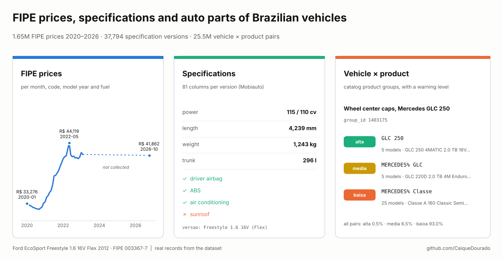
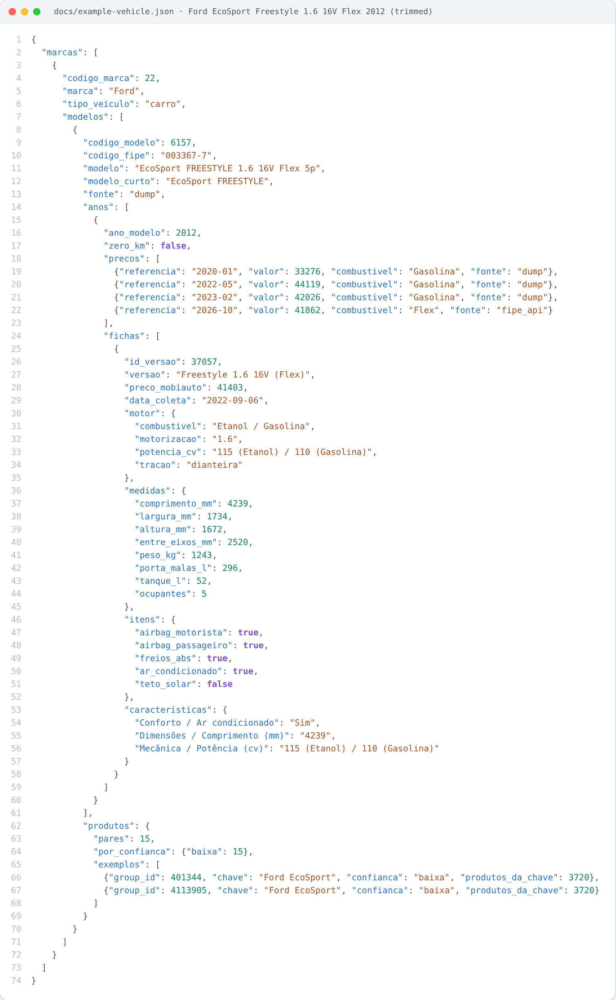
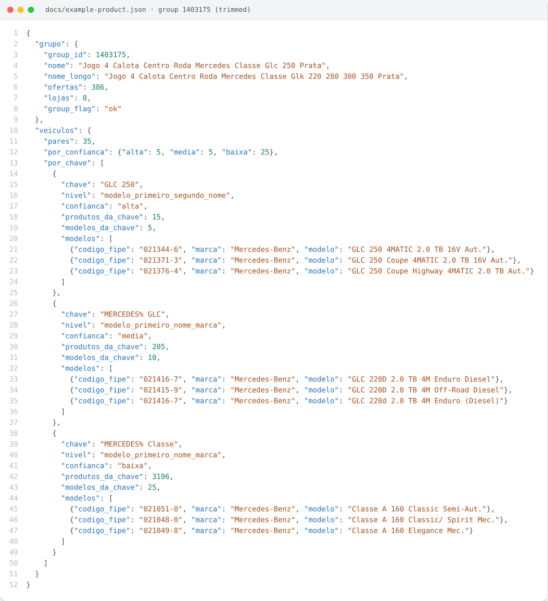
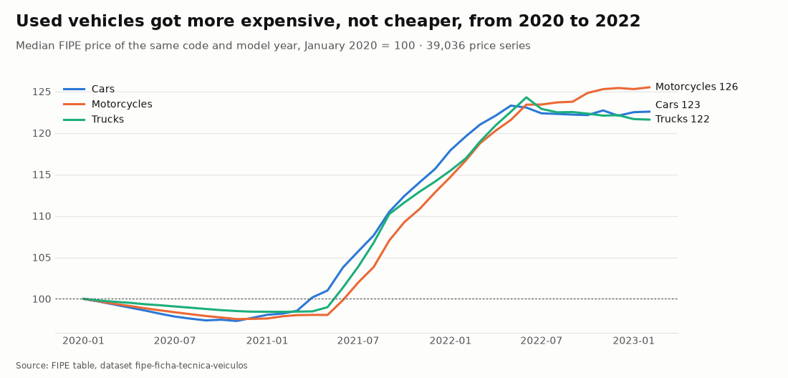
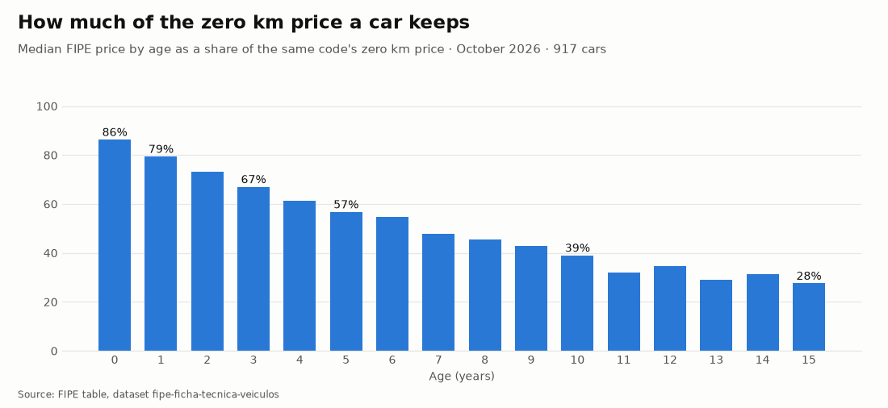
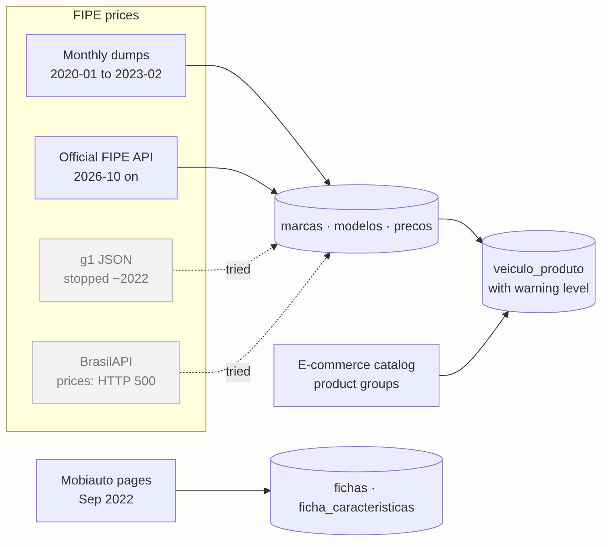

# Tabela FIPE e ficha técnica de veículos · FIPE vehicle prices and specifications (Brazil)

[](https://github.com/CaiqueDourado/fipe-ficha-tecnica-veiculos/actions/workflows/validate.yml)
[](LICENSE-DATA.md)
[](LICENSE)
[](https://www.kaggle.com/datasets/caiquedourado/fipe-ficha-tecnica-veiculos)

[Leia em português](README.pt-BR.md)



Brazilian vehicle data in three parts:

- **FIPE prices**, the monthly reference of used and new vehicle prices in Brazil: 1.65 million prices of
  cars, motorcycles and trucks from January 2020 to February 2023, plus October 2026 collected from the
  official FIPE site.
- **Specifications** of 37,794 car and motorcycle versions: engine, power, consumption, dimensions and 58
  yes/no items (airbags, ABS, air conditioning...), from the FIPE pages of Mobiauto, September 2022.
- **Vehicle × product matches**: 25.5 million candidate pairs between FIPE models and the product groups
  of the [e-commerce catalog dataset](https://github.com/CaiqueDourado/catalogo-produtos-ecommerce-brasil)
  (floor mats, wiper blades, covers...), each with a warning level, because most are wrong.

## How each vehicle is structured

Linked by FIPE code and model year, the seven tables nest into one record per vehicle: **brand → model
(FIPE code) → model year → monthly prices and specification versions**, plus the product pairs of the
model. `scripts/make_json.py` writes it, from `sample/` or from the full Kaggle files. The Ford EcoSport
Freestyle 1.6 16V Flex 2012, trimmed (the whole record, with its 39 prices and 81 specifications per
version, is in [docs/example-vehicle.json](docs/example-vehicle.json)):



<details><summary>JSON as text</summary>

```json
{
  "marcas": [
    {
      "codigo_marca": 22,
      "marca": "Ford",
      "tipo_veiculo": "carro",
      "modelos": [
        {
          "codigo_modelo": 6157,
          "codigo_fipe": "003367-7",
          "modelo": "EcoSport FREESTYLE 1.6 16V Flex 5p",
          "modelo_curto": "EcoSport FREESTYLE",
          "fonte": "dump",
          "anos": [
            {
              "ano_modelo": 2012,
              "zero_km": false,
              "precos": [
                {"referencia": "2020-01", "valor": 33276, "combustivel": "Gasolina", "fonte": "dump"},
                {"referencia": "2022-05", "valor": 44119, "combustivel": "Gasolina", "fonte": "dump"},
                {"referencia": "2023-02", "valor": 42026, "combustivel": "Gasolina", "fonte": "dump"},
                {"referencia": "2026-10", "valor": 41862, "combustivel": "Flex", "fonte": "fipe_api"}
              ],
              "fichas": [
                {
                  "id_versao": 37057,
                  "versao": "Freestyle 1.6 16V (Flex)",
                  "preco_mobiauto": 41403,
                  "data_coleta": "2022-09-06",
                  "motor": {
                    "combustivel": "Etanol / Gasolina",
                    "motorizacao": "1.6",
                    "potencia_cv": "115 (Etanol) / 110 (Gasolina)",
                    "tracao": "dianteira",
                    "freios_dianteiros": "Dois freios à disco com dois discos ventilados."
                  },
                  "medidas": {
                    "comprimento_mm": 4239,
                    "largura_mm": 1734,
                    "altura_mm": 1672,
                    "entre_eixos_mm": 2520,
                    "peso_kg": 1243,
                    "porta_malas_l": 296,
                    "tanque_l": 52,
                    "ocupantes": 5
                  },
                  "itens": {
                    "airbag_motorista": true,
                    "airbag_passageiro": true,
                    "freios_abs": true,
                    "ar_condicionado": true,
                    "teto_solar": false
                  },
                  "caracteristicas": {
                    "Conforto / Ar condicionado": "Sim",
                    "Dimensões / Comprimento (mm)": "4239",
                    "Mecânica / Potência (cv)": "115 (Etanol) / 110 (Gasolina)"
                  }
                }
              ]
            }
          ],
          "produtos": {
            "pares": 15,
            "por_confianca": {"baixa": 15},
            "exemplos": [
              {"group_id": 401344, "chave": "Ford EcoSport", "confianca": "baixa", "produtos_da_chave": 3720},
              {
                "group_id": 4113905,
                "chave": "Ford EcoSport",
                "confianca": "baixa",
                "produtos_da_chave": 3720
              }
            ]
          }
        }
      ]
    }
  ]
}
```

</details>

- `precos`: one entry per reference month. The fuel changed from "Gasolina" to "Flex" between the two
  sources ([data quality](docs/data-quality.md)).
- `fichas`: every Mobiauto version of that FIPE code and year. FIPE prices one "EcoSport FREESTYLE 1.6 16V
  Flex 5p"; Mobiauto lists two versions under the same code, with different power and equipment.
- `medidas` and `itens` are typed columns of `fichas`; `caracteristicas` is the same page as text,
  `"section / key": "value"`.
- `produtos`: pair counts by warning level and up to five examples, best level first. In the sample the
  counts are the sample's.

```bash
python scripts/make_json.py                                           # sample/ -> sample/veiculos_sample.json
python scripts/make_json.py --fipe 003367-7 --ano 2012 --out carro.json
python scripts/make_json.py --data <kaggle folder> --out veiculos.jsonl # all models, one per line
```

### The same pairs, from the product side

`veiculo_produto` read the other way: one product group of the [e-commerce catalog](https://github.com/CaiqueDourado/catalogo-produtos-ecommerce-brasil) and every FIPE
vehicle matched to it, grouped by the key that matched. A set of wheel center caps for the Mercedes GLC 250,
trimmed (the whole record is in [docs/example-product.json](docs/example-product.json)):



- **`GLC 250` (alta)**: the key matched 15 product groups, and the 5 models are the car in the product name.
- **`MERCEDES% GLC` (media)**: brand and first word, 205 groups. Other GLC versions (220d): plausible, not
  what the product says.
- **`MERCEDES% Classe` (baixa)**: "Classe" is in the product name too, so 25 Classe A models came along.
  Wrong, and typical of `baixa`.
- `%` is the wildcard of the original SQL match: `MERCEDES%` stands for "Mercedes-Benz".
- The group itself mixes GLC and GLK caps: `nome` and `nome_longo` come from different offers of the catalog.

<details><summary>JSON as text</summary>

```json
{
  "grupo": {
    "group_id": 1403175,
    "nome": "Jogo 4 Calota Centro Roda Mercedes Classe Glc 250 Prata",
    "nome_longo": "Jogo 4 Calota Centro Roda Mercedes Classe Glk 220 280 300 350 Prata",
    "ofertas": 386,
    "lojas": 8,
    "group_flag": "ok"
  },
  "veiculos": {
    "pares": 35,
    "por_confianca": {"alta": 5, "media": 5, "baixa": 25},
    "por_chave": [
      {
        "chave": "GLC 250",
        "nivel": "modelo_primeiro_segundo_nome",
        "confianca": "alta",
        "produtos_da_chave": 15,
        "modelos_da_chave": 5,
        "modelos": [
          {"codigo_fipe": "021344-6", "marca": "Mercedes-Benz", "modelo": "GLC 250 4MATIC 2.0 TB 16V Aut."},
          {"codigo_fipe": "021371-3", "marca": "Mercedes-Benz", "modelo": "GLC 250 Coupe 4MATIC 2.0 TB 16V Aut."},
          {"codigo_fipe": "021376-4", "marca": "Mercedes-Benz", "modelo": "GLC 250 Coupe Highway 4MATIC 2.0 TB Aut."}
        ]
      },
      {
        "chave": "MERCEDES% GLC",
        "nivel": "modelo_primeiro_nome_marca",
        "confianca": "media",
        "produtos_da_chave": 205,
        "modelos_da_chave": 10,
        "modelos": [
          {"codigo_fipe": "021416-7", "marca": "Mercedes-Benz", "modelo": "GLC 220D 2.0 TB 4M Enduro Diesel"},
          {"codigo_fipe": "021415-9", "marca": "Mercedes-Benz", "modelo": "GLC 220D 2.0 TB 4M Off-Road Diesel"},
          {"codigo_fipe": "021416-7", "marca": "Mercedes-Benz", "modelo": "GLC 220d 2.0 TB 4M Enduro (Diesel)"}
        ]
      },
      {
        "chave": "MERCEDES% Classe",
        "nivel": "modelo_primeiro_nome_marca",
        "confianca": "baixa",
        "produtos_da_chave": 3196,
        "modelos_da_chave": 25,
        "modelos": [
          {"codigo_fipe": "021051-0", "marca": "Mercedes-Benz", "modelo": "Classe A 160 Classic Semi-Aut."},
          {"codigo_fipe": "021048-0", "marca": "Mercedes-Benz", "modelo": "Classe A 160 Classic/ Spirit Mec."},
          {"codigo_fipe": "021049-8", "marca": "Mercedes-Benz", "modelo": "Classe A 160 Elegance Mec."}
        ]
      }
    ]
  }
}
```

</details>

```bash
# needs the full Parquet files of this dataset and grupos.parquet of the catalog
python scripts/make_product_json.py --data <kaggle folder> --catalog <catalog folder> --list          # candidates
python scripts/make_product_json.py --data <kaggle folder> --catalog <catalog folder> --group 1403175
```

## Files

| File | Rows | What |
|---|---:|---|
| `marcas` | 245 | FIPE brands and vehicle type |
| `modelos` | 11,948 | FIPE models (versions), FIPE code, short names used for matching |
| `precos` | 1,653,840 | price per month, FIPE code, model year and fuel |
| `fichas` | 37,794 | one row per version, 81 specification columns |
| `ficha_caracteristicas` | 2,704,962 | the same specifications in long form |
| `ficha_titulos` | 87 | section titles and FAQ questions for writing text from the specifications |
| `veiculo_produto` | 25,456,723 | vehicle model × product group, with `confianca` (alta, media, baixa) |

The full files (Parquet) are on [Kaggle](https://www.kaggle.com/datasets/caiquedourado/fipe-ficha-tecnica-veiculos).
This repository has the scripts, the documentation and `sample/`: every row of 300 random models.

## One car in all three parts

**Ford EcoSport Freestyle 1.6 16V Flex 2012** (FIPE code `003367-7`, model 6157), in `sample/`:

| | |
|---|---|
| FIPE, January 2020 | R$ 33,276 |
| FIPE, January 2022 | R$ 41,247 |
| FIPE, February 2023 | R$ 42,026 |
| FIPE, October 2026 | R$ 41,862 |
| Mobiauto, September 2022 | R$ 41,403 |
| Specifications | 115 cv (ethanol) / 110 cv (gasoline), 296 l trunk, driver and passenger airbags, ABS |
| Products matched by "EcoSport" | all `confianca = baixa`: the key matched 12,656 products |

A car that was eight years old in 2020 became 24% more expensive in two years, and in October 2026 it was
still worth 26% more than in January 2020. It was not an exception:



Used cars, motorcycles and trucks of the same FIPE code and model year rose 20–28% from mid-2021 to
mid-2022, when new vehicles were scarce, and did not come back down by February 2023.

How much of the zero km price a car keeps, by age, in October 2026 (median of 917 cars with a zero km
price and used prices of the same FIPE code):



86% in the first year, 57% after five years, 39% after ten and 28% after fifteen.

## Where the data came from



- **2020–2023:** monthly FIPE table dumps loaded into the author's SQL Server for his vehicle sites
  (prices, "how much is a used X", auto parts by model).
- **2026:** to bring the series up to date, the project first tried the **g1** FIPE JSON files that power
  Globo's price page (they stopped around 2022 and have no reference month), then **BrasilAPI** (its price
  endpoint was failing on FIPE's side), and settled on the **official FIPE site's JSON API**, the source
  both relay. The collector is resumable and keeps to the site's rate limit (it slows down on HTTP 429).
- **Specifications:** a crawler over Mobiauto's FIPE pages in September 2022. The yes/no items are icons on
  the page; the crawler told "yes" from "no" by the SVG path of each icon.
- **Vehicle × product:** the author's 2022 name matching (FIPE model names searched inside catalog product
  names), published as it ran, with how wide each key was.

Details: [methodology](docs/methodology.md). What is wrong and what was fixed: [data quality report](docs/data-quality.md).

### The three FIPE sources, with real answers

[docs/apis.md](docs/apis.md) shows each request and the answer it got on 22/10/2026. In short:

| Source | Call | Answer |
|---|---|---|
| g1 | `GET g1.globo.com/static/fipe/json/carro/023067-7.json` | `[{"tipo": "2013 gasolina", "valor": "29732"}, …]`: no reference month, stale |
| BrasilAPI | `GET brasilapi.com.br/api/fipe/preco/v1/023067-7` | HTTP 500, "Fonte de dados FIPE temporariamente indisponível" |
| FIPE (used) | `POST veiculos.fipe.org.br/api/veiculos/ConsultarValorComTodosParametros` | `{"Valor": "R$ 57.839,00", "CodigoFipe": "003367-7", "MesReferencia": "outubro de 2026 ", …}` |

The official API takes five POST calls to reach a price: reference months, brands, models, model years,
price.

## Use it

```python
import pandas as pd

precos = pd.read_csv("sample/precos_sample.csv", dtype={"codigo_fipe": str}, parse_dates=["referencia"])
fichas = pd.read_csv("sample/fichas_sample.csv", dtype={"codigo_fipe": str})

# price history of one version and model year
precos.query("codigo_fipe == '003367-7' and ano_modelo == 2012").set_index("referencia").valor

# specifications next to the FIPE price of the same code and year
last = precos[precos.referencia == "2026-10-01"]
fichas.merge(last, on=["codigo_fipe", "ano_modelo"])[["marca", "versao", "ano_modelo", "potencia_cv", "valor"]]
```

```sql
-- DuckDB, full files from Kaggle: only the matches you can trust
SELECT m.modelo, v.group_id, v.chave
FROM 'veiculo_produto.parquet' v JOIN 'modelos.parquet' m USING (codigo_modelo)
WHERE v.confianca = 'alta';
```

`group_id` joins with the `grupos` table of the [catalog](https://www.kaggle.com/datasets/caiquedourado/catalogo-produtos-ecommerce-brasil)
(product names, prices, EANs).

Every column: [data dictionary](docs/data-dictionary.md) ([pt-BR](docs/data-dictionary.pt-BR.md)).

## Text from the data

`textos/` writes Portuguese text from these tables, by rules: the "about" paragraph of a version, its
equipment by section, its FIPE price history, a FAQ and its JSON-LD. It is the author's 2022 page generator
("Tudo sobre <marca> <modelo>") rewritten, with its bugs fixed ([methodology, section 4](docs/methodology.md#4-text-from-the-data)).

```bash
pip install "git+https://github.com/CaiqueDourado/fipe-ficha-tecnica-veiculos"
python -m textos sample 003367-7 2012
```

```python
from textos import Vehicle, history
v = Vehicle(fichas.query("codigo_fipe == '003367-7' and ano_modelo == 2012").iloc[1])
v.about()
```

> O Ford EcoSport Freestyle 1.6 16V (Flex) 2012 tem motor 1.6, tração dianteira. É flex (etanol ou
> gasolina). A potência é de 115 cv com etanol e 110 cv com gasolina, e o torque, de 16,2 kgf.m com etanol
> e 15,8 kgf.m com gasolina. Mede 4,24 m de comprimento, 1,73 m de largura e 1,67 m de altura…

```python
v.equipment()   # {'Itens de segurança': 'Itens de segurança disponíveis: airbag do motorista, airbag do passageiro, alarme, controle de tração, distribuição eletrônica de frenagem (EBD) e freios ABS.', ...}
v.faq()         # [..., ('O Ford EcoSport Freestyle 1.6 16V (Flex) 2012 tem freios ABS?', 'Sim, o Ford EcoSport Freestyle 1.6 16V (Flex) 2012 tem freios ABS.'), ...]
serie = precos.query("codigo_fipe == '003367-7' and ano_modelo == 2012").sort_values("referencia")
history(zip(serie.referencia, serie.valor), v.title)
```

> Em outubro de 2026, o Ford EcoSport Freestyle 1.6 16V (Flex) 2012 valia R$ 41.862 na tabela FIPE, 26% a mais
> que em janeiro de 2020 (R$ 33.276). O maior valor foi R$ 44.119, em maio de 2022.

## Repository layout

```text
sample/        every row of 300 random models, in CSV
schema/        column definitions and dataset metadata
scripts/       exportar_fipe.py (SQL Server -> Parquet), coletor_fipe.py (official FIPE API),
               probe_globo_fipe.py, probe_brasilapi_fipe.py, perfil_fipe.py, build_veiculos.py,
               validate.py, make_figures.py, make_json.py, make_product_json.py,
               make_json_image.py, docs.py
textos/        text from the data (python -m textos); tests/ its tests
notebooks/     eda.ipynb
docs/          methodology, data quality, APIs, data dictionary, example JSON, Kaggle description, images
kaggle/        dataset-metadata.json
stats.json     counts of every build step
```

## Related

- [catalogo-produtos-ecommerce-brasil](https://github.com/CaiqueDourado/catalogo-produtos-ecommerce-brasil): the product groups of `veiculo_produto`.
- [DedupKit](https://github.com/CaiqueDourado/DedupKit): matching product names in Portuguese, the problem behind the noise in `veiculo_produto`.
- [PtBr.Text](https://github.com/CaiqueDourado/PtBr.Text): Portuguese text from data for .NET (numbers in words, money, plural and gender), the same idea as `textos/`.
- [municipios-e-estados-do-brasil](https://github.com/CaiqueDourado/municipios-e-estados-do-brasil): Brazilian states and cities, for regional analysis.

## License

The compilation and the derived columns are [CC BY 4.0](LICENSE-DATA.md). Code: [MIT](LICENSE). Removal requests: open an issue.

## Author

**Caique Dourado**: 20 years building crawlers, data pipelines and programmatic SEO in .NET and SQL Server. More at [github.com/CaiqueDourado](https://github.com/CaiqueDourado).
