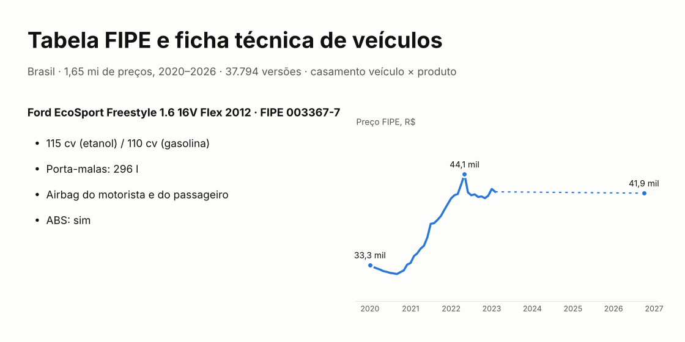
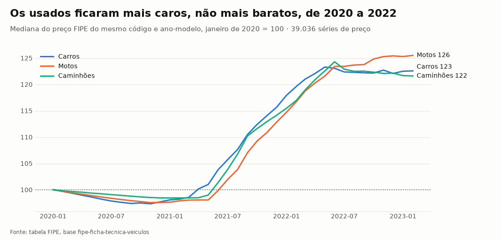
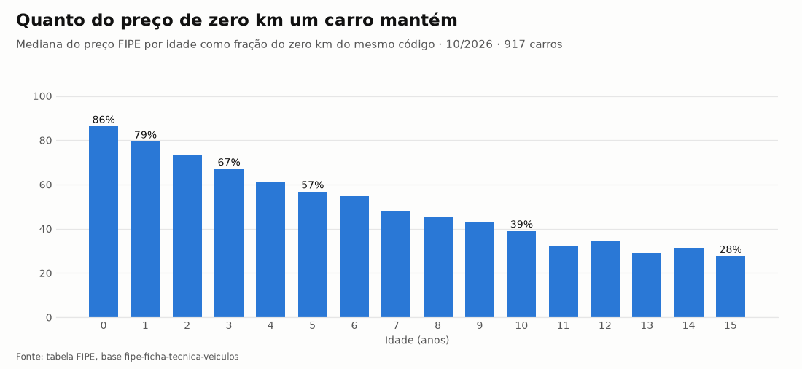
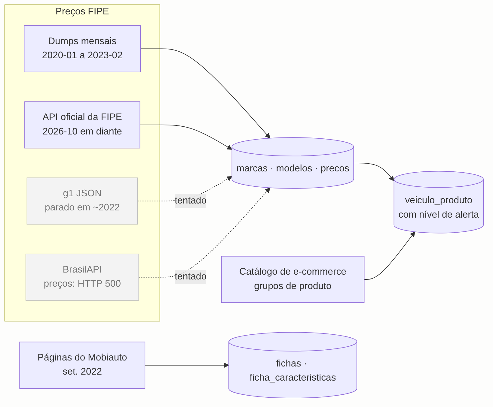

# Tabela FIPE e ficha técnica de veículos

[](https://github.com/CaiqueDourado/fipe-ficha-tecnica-veiculos/actions/workflows/validate.yml)
[](LICENSE-DATA.md)
[](LICENSE)
[](https://www.kaggle.com/datasets/caiquedourado/fipe-ficha-tecnica-veiculos)

[Read in English](README.md)



Dados de veículos do Brasil em três partes:

- **Preços FIPE**, a referência mensal de preços de veículos usados e novos no Brasil. São 1,65 milhão de
  preços de carros, motos e caminhões, de janeiro de 2020 a fevereiro de 2023, mais outubro de 2026,
  coletado no site oficial da FIPE.
- **Ficha técnica** de 37.794 versões de carros e motos: motor, potência, consumo, medidas e 58 itens de
  sim ou não (airbags, ABS, ar-condicionado...). Veio das páginas da tabela FIPE do Mobiauto, em setembro
  de 2022.
- **Casamento veículo × produto**: 25,5 milhões de pares candidatos entre modelos da FIPE e os grupos de
  produto da [base do catálogo de e-commerce](https://github.com/CaiqueDourado/catalogo-produtos-ecommerce-brasil)
  (tapetes, palhetas, capas...). Cada par tem um nível de alerta, porque a maioria está errada.

## Como cada veículo está estruturado

Ligadas por código FIPE e ano-modelo, as sete tabelas se encaixam num registro por veículo: **marca →
modelo (código FIPE) → ano-modelo → preços por mês e versões da ficha técnica**, mais os pares de produto
do modelo. O `scripts/make_json.py` escreve essa árvore a partir de `sample/` ou dos arquivos completos do
Kaggle. O Ford EcoSport Freestyle 1.6 16V Flex 2012, resumido (o registro inteiro, com os 39 preços e as 81
características de cada versão, está em [docs/example-vehicle.json](docs/example-vehicle.json)):


<details><summary>JSON em texto</summary>

```json
{
  "marcas": [
    {
      "codigo_marca": 22,
      "marca": "Ford",
      "tipo_veiculo": "carro",
      "modelos": [
        {
          "codigo_modelo": 6157,
          "codigo_fipe": "003367-7",
          "modelo": "EcoSport FREESTYLE 1.6 16V Flex 5p",
          "modelo_curto": "EcoSport FREESTYLE",
          "fonte": "dump",
          "anos": [
            {
              "ano_modelo": 2012,
              "zero_km": false,
              "precos": [
                {"referencia": "2020-01", "valor": 33276, "combustivel": "Gasolina", "fonte": "dump"},
                {"referencia": "2022-05", "valor": 44119, "combustivel": "Gasolina", "fonte": "dump"},
                {"referencia": "2023-02", "valor": 42026, "combustivel": "Gasolina", "fonte": "dump"},
                {"referencia": "2026-10", "valor": 41862, "combustivel": "Flex", "fonte": "fipe_api"}
              ],
              "fichas": [
                {
                  "id_versao": 37057,
                  "versao": "Freestyle 1.6 16V (Flex)",
                  "preco_mobiauto": 41403,
                  "data_coleta": "2022-09-06",
                  "motor": {
                    "combustivel": "Etanol / Gasolina",
                    "motorizacao": "1.6",
                    "potencia_cv": "115 (Etanol) / 110 (Gasolina)",
                    "tracao": "dianteira",
                    "freios_dianteiros": "Dois freios à disco com dois discos ventilados."
                  },
                  "medidas": {
                    "comprimento_mm": 4239,
                    "largura_mm": 1734,
                    "altura_mm": 1672,
                    "entre_eixos_mm": 2520,
                    "peso_kg": 1243,
                    "porta_malas_l": 296,
                    "tanque_l": 52,
                    "ocupantes": 5
                  },
                  "itens": {
                    "airbag_motorista": true,
                    "airbag_passageiro": true,
                    "freios_abs": true,
                    "ar_condicionado": true,
                    "teto_solar": false
                  },
                  "caracteristicas": {
                    "Conforto / Ar condicionado": "Sim",
                    "Dimensões / Comprimento (mm)": "4239",
                    "Mecânica / Potência (cv)": "115 (Etanol) / 110 (Gasolina)"
                  }
                }
              ]
            }
          ],
          "produtos": {
            "pares": 15,
            "por_confianca": {"baixa": 15},
            "exemplos": [
              {"group_id": 401344, "chave": "Ford EcoSport", "confianca": "baixa", "produtos_da_chave": 3720},
              {
                "group_id": 4113905,
                "chave": "Ford EcoSport",
                "confianca": "baixa",
                "produtos_da_chave": 3720
              }
            ]
          }
        }
      ]
    }
  ]
}
```

</details>

- `precos`: um item por mês de referência. O combustível mudou de "Gasolina" para "Flex" entre as duas
  fontes ([qualidade dos dados](docs/data-quality.md), em inglês).
- `fichas`: todas as versões do Mobiauto daquele código FIPE e ano. A FIPE dá um preço para "EcoSport
  FREESTYLE 1.6 16V Flex 5p"; o Mobiauto lista duas versões no mesmo código, com potência e itens
  diferentes.
- `medidas` e `itens` são colunas tipadas de `fichas`; `caracteristicas` é a mesma página em texto,
  `"seção / chave": "valor"`.
- `produtos`: quantos pares por nível de alerta e até cinco exemplos, do melhor nível para o pior. Na
  amostra, as contagens são as da amostra.

```bash
python scripts/make_json.py                                           # sample/ -> sample/veiculos_sample.json
python scripts/make_json.py --fipe 003367-7 --ano 2012 --out carro.json
python scripts/make_json.py --data <pasta do Kaggle> --out veiculos.jsonl # todos os modelos, um por linha
```

### Os mesmos pares, do lado do produto

O `veiculo_produto` lido ao contrário: um grupo de produto do [catálogo de e-commerce](https://github.com/CaiqueDourado/catalogo-produtos-ecommerce-brasil) e todos os
veículos da FIPE casados com ele, agrupados pela chave que casou. Um jogo de calotas de centro de roda para o
Mercedes GLC 250, resumido (o registro inteiro está em [docs/example-product.json](docs/example-product.json)):


- **`GLC 250` (alta)**: a chave casou 15 grupos de produto, e os 5 modelos são o carro do nome do produto.
- **`MERCEDES% GLC` (media)**: marca e primeiro nome, 205 grupos. Outras versões do GLC (220d): plausível,
  mas não é o que o produto diz.
- **`MERCEDES% Classe` (baixa)**: "Classe" também está no nome do produto, então vieram 25 modelos Classe A.
  Errado, e típico de `baixa`.
- O `%` é o curinga do SQL original: `MERCEDES%` quer dizer "Mercedes-Benz".
- O próprio grupo mistura calotas de GLC e GLK: `nome` e `nome_longo` vêm de ofertas diferentes do catálogo.

<details><summary>JSON em texto</summary>

```json
{
  "grupo": {
    "group_id": 1403175,
    "nome": "Jogo 4 Calota Centro Roda Mercedes Classe Glc 250 Prata",
    "nome_longo": "Jogo 4 Calota Centro Roda Mercedes Classe Glk 220 280 300 350 Prata",
    "ofertas": 386,
    "lojas": 8,
    "group_flag": "ok"
  },
  "veiculos": {
    "pares": 35,
    "por_confianca": {"alta": 5, "media": 5, "baixa": 25},
    "por_chave": [
      {
        "chave": "GLC 250",
        "nivel": "modelo_primeiro_segundo_nome",
        "confianca": "alta",
        "produtos_da_chave": 15,
        "modelos_da_chave": 5,
        "modelos": [
          {"codigo_fipe": "021344-6", "marca": "Mercedes-Benz", "modelo": "GLC 250 4MATIC 2.0 TB 16V Aut."},
          {"codigo_fipe": "021371-3", "marca": "Mercedes-Benz", "modelo": "GLC 250 Coupe 4MATIC 2.0 TB 16V Aut."},
          {"codigo_fipe": "021376-4", "marca": "Mercedes-Benz", "modelo": "GLC 250 Coupe Highway 4MATIC 2.0 TB Aut."}
        ]
      },
      {
        "chave": "MERCEDES% GLC",
        "nivel": "modelo_primeiro_nome_marca",
        "confianca": "media",
        "produtos_da_chave": 205,
        "modelos_da_chave": 10,
        "modelos": [
          {"codigo_fipe": "021416-7", "marca": "Mercedes-Benz", "modelo": "GLC 220D 2.0 TB 4M Enduro Diesel"},
          {"codigo_fipe": "021415-9", "marca": "Mercedes-Benz", "modelo": "GLC 220D 2.0 TB 4M Off-Road Diesel"},
          {"codigo_fipe": "021416-7", "marca": "Mercedes-Benz", "modelo": "GLC 220d 2.0 TB 4M Enduro (Diesel)"}
        ]
      },
      {
        "chave": "MERCEDES% Classe",
        "nivel": "modelo_primeiro_nome_marca",
        "confianca": "baixa",
        "produtos_da_chave": 3196,
        "modelos_da_chave": 25,
        "modelos": [
          {"codigo_fipe": "021051-0", "marca": "Mercedes-Benz", "modelo": "Classe A 160 Classic Semi-Aut."},
          {"codigo_fipe": "021048-0", "marca": "Mercedes-Benz", "modelo": "Classe A 160 Classic/ Spirit Mec."},
          {"codigo_fipe": "021049-8", "marca": "Mercedes-Benz", "modelo": "Classe A 160 Elegance Mec."}
        ]
      }
    ]
  }
}
```

</details>

```bash
# precisa dos Parquet completos deste dataset e do grupos.parquet do catálogo
python scripts/make_product_json.py --data <pasta do Kaggle> --catalog <pasta do catálogo> --list          # candidatos
python scripts/make_product_json.py --data <pasta do Kaggle> --catalog <pasta do catálogo> --group 1403175
```

## Arquivos

| Arquivo | Linhas | O que tem |
|---|---:|---|
| `marcas` | 245 | marcas da FIPE e tipo de veículo |
| `modelos` | 11.948 | modelos (versões) da FIPE, código FIPE e nomes curtos usados no casamento |
| `precos` | 1.653.840 | preço por mês, código FIPE, ano-modelo e combustível |
| `fichas` | 37.794 | uma linha por versão, com 81 colunas de ficha técnica |
| `ficha_caracteristicas` | 2.704.962 | a mesma ficha em formato longo |
| `ficha_titulos` | 87 | títulos de seção e perguntas de FAQ para escrever texto a partir da ficha |
| `veiculo_produto` | 25.456.723 | modelo de veículo × grupo de produto, com `confianca` (alta, media, baixa) |

Os arquivos completos (Parquet) estão no [Kaggle](https://www.kaggle.com/datasets/caiquedourado/fipe-ficha-tecnica-veiculos).
Este repositório tem os scripts, a documentação e a pasta `sample/`, com todas as linhas de 300 modelos
sorteados.

## Um carro nas três partes

**Ford EcoSport Freestyle 1.6 16V Flex 2012** (código FIPE `003367-7`, modelo 6157), em `sample/`:

| | |
|---|---|
| FIPE, janeiro de 2020 | R$ 33.276 |
| FIPE, janeiro de 2022 | R$ 41.247 |
| FIPE, fevereiro de 2023 | R$ 42.026 |
| FIPE, outubro de 2026 | R$ 41.862 |
| Mobiauto, setembro de 2022 | R$ 41.403 |
| Ficha técnica | 115 cv (etanol) / 110 cv (gasolina), porta-malas de 296 l, airbag do motorista e do passageiro, ABS |
| Produtos casados por "EcoSport" | todos com `confianca = baixa`: a chave casou 12.656 produtos |

Um carro que tinha oito anos em 2020 ficou 24% mais caro em dois anos, e em outubro de 2026 ainda valia
26% a mais que em janeiro de 2020. Não foi exceção:



Carros, motos e caminhões usados, do mesmo código FIPE e ano-modelo, subiram de 20% a 28% entre meados de
2021 e meados de 2022, quando faltavam veículos novos. Em fevereiro de 2023, os preços ainda não tinham
voltado.

Quanto do preço de zero km um carro mantém, por idade, em outubro de 2026 (mediana de 917 carros com preço
de zero km e preços de usado do mesmo código FIPE):



86% no primeiro ano, 57% depois de cinco anos, 39% depois de dez e 28% depois de quinze.

## De onde vieram os dados



- **2020–2023:** dumps mensais da tabela FIPE, carregados no SQL Server do autor para os sites de veículos
  dele (preços, "quanto custa um X usado", autopeças por modelo).
- **2026:** para atualizar a série, o projeto passou por três fontes:
  1. Primeiro, os arquivos JSON do **g1** que alimentam a página de preços da Globo. Eles pararam por volta
     de 2022 e não trazem o mês de referência.
  2. Depois, a **BrasilAPI**. A busca de preços dela estava falhando do lado da FIPE.
  3. Por fim, a **API JSON do site oficial da FIPE**, que é a fonte que as duas anteriores repassam. Ficou
     esta.

  O coletor pode parar e continuar de onde parou, e respeita o limite do site: quando recebe HTTP 429, vai
  mais devagar.
- **Ficha técnica:** um crawler nas páginas da tabela FIPE do Mobiauto, em setembro de 2022. Os itens de
  sim ou não são ícones na página, e o crawler distinguia "sim" de "não" pelo desenho (path SVG) de cada
  ícone.
- **Veículo × produto:** é o casamento por nome feito pelo autor em 2022. Os nomes dos modelos da FIPE
  foram procurados dentro dos nomes dos produtos do catálogo. A tabela está publicada como rodou, com a
  abrangência de cada chave.

Detalhes na [metodologia](docs/methodology.md) (em inglês). O que está errado e o que foi corrigido está no
[relatório de qualidade](docs/data-quality.md).

### As três fontes da FIPE, com respostas reais

O [docs/apis.md](docs/apis.md) (em inglês) mostra cada pedido e a resposta que veio em 22/10/2026. Resumo:

| Fonte | Chamada | Resposta |
|---|---|---|
| g1 | `GET g1.globo.com/static/fipe/json/carro/023067-7.json` | `[{"tipo": "2013 gasolina", "valor": "29732"}, …]`: sem mês de referência, desatualizado |
| BrasilAPI | `GET brasilapi.com.br/api/fipe/preco/v1/023067-7` | HTTP 500, "Fonte de dados FIPE temporariamente indisponível" |
| FIPE (usada) | `POST veiculos.fipe.org.br/api/veiculos/ConsultarValorComTodosParametros` | `{"Valor": "R$ 57.839,00", "CodigoFipe": "003367-7", "MesReferencia": "outubro de 2026 ", …}` |

A API oficial pede cinco chamadas POST até o preço: meses de referência, marcas, modelos, anos-modelo e
preço.

## Como usar

```python
import pandas as pd

precos = pd.read_csv("sample/precos_sample.csv", dtype={"codigo_fipe": str}, parse_dates=["referencia"])
fichas = pd.read_csv("sample/fichas_sample.csv", dtype={"codigo_fipe": str})

# histórico de preço de uma versão e ano-modelo
precos.query("codigo_fipe == '003367-7' and ano_modelo == 2012").set_index("referencia").valor

# ficha técnica ao lado do preço FIPE do mesmo código e ano
ultimo = precos[precos.referencia == "2026-10-01"]
fichas.merge(ultimo, on=["codigo_fipe", "ano_modelo"])[["marca", "versao", "ano_modelo", "potencia_cv", "valor"]]
```

```sql
-- DuckDB, arquivos completos do Kaggle: só os casamentos confiáveis
SELECT m.modelo, v.group_id, v.chave
FROM 'veiculo_produto.parquet' v JOIN 'modelos.parquet' m USING (codigo_modelo)
WHERE v.confianca = 'alta';
```

`group_id` liga com a tabela `grupos` do [catálogo](https://www.kaggle.com/datasets/caiquedourado/catalogo-produtos-ecommerce-brasil),
que tem nomes de produtos, preços e EANs.

Cada coluna está no [dicionário de dados](docs/data-dictionary.pt-BR.md) ([EN](docs/data-dictionary.md)).

## Texto a partir dos dados

A pasta `textos/` escreve texto em português a partir destas tabelas, por regras:

- o parágrafo "sobre" de uma versão;
- os itens de série por seção;
- o histórico de preço FIPE;
- um FAQ, com o JSON-LD dele.

É o gerador de páginas de 2022 do autor ("Tudo sobre <marca> <modelo>") reescrito, com os erros
corrigidos ([metodologia, seção 4](docs/methodology.md#4-text-from-the-data), em inglês).

```bash
pip install "git+https://github.com/CaiqueDourado/fipe-ficha-tecnica-veiculos"
python -m textos sample 003367-7 2012
```

```python
from textos import Vehicle, history
v = Vehicle(fichas.query("codigo_fipe == '003367-7' and ano_modelo == 2012").iloc[1])
v.about()
```

> O Ford EcoSport Freestyle 1.6 16V (Flex) 2012 tem motor 1.6, tração dianteira. É flex (etanol ou
> gasolina). A potência é de 115 cv com etanol e 110 cv com gasolina, e o torque, de 16,2 kgf.m com etanol
> e 15,8 kgf.m com gasolina. Mede 4,24 m de comprimento, 1,73 m de largura e 1,67 m de altura…

```python
v.equipment()   # {'Itens de segurança': 'Itens de segurança disponíveis: airbag do motorista, airbag do passageiro, alarme, controle de tração, distribuição eletrônica de frenagem (EBD) e freios ABS.', ...}
v.faq()         # [..., ('O Ford EcoSport Freestyle 1.6 16V (Flex) 2012 tem freios ABS?', 'Sim, o Ford EcoSport Freestyle 1.6 16V (Flex) 2012 tem freios ABS.'), ...]
serie = precos.query("codigo_fipe == '003367-7' and ano_modelo == 2012").sort_values("referencia")
history(zip(serie.referencia, serie.valor), v.title)
```

> Em outubro de 2026, o Ford EcoSport Freestyle 1.6 16V (Flex) 2012 valia R$ 41.862 na tabela FIPE, 26% a mais
> que em janeiro de 2020 (R$ 33.276). O maior valor foi R$ 44.119, em maio de 2022.

## Estrutura do repositório

```text
sample/        todas as linhas de 300 modelos sorteados, em CSV
schema/        definição das colunas e metadados
scripts/       exportar_fipe.py (SQL Server -> Parquet), coletor_fipe.py (API oficial da FIPE),
               probe_globo_fipe.py, probe_brasilapi_fipe.py, perfil_fipe.py, build_veiculos.py,
               validate.py, make_figures.py, make_json.py, make_product_json.py,
               make_json_image.py, docs.py
textos/        texto a partir dos dados (python -m textos); tests/ os testes
notebooks/     eda.ipynb
docs/          metodologia, qualidade, APIs, dicionário de dados, JSON de exemplo, descrição do Kaggle, imagens
kaggle/        dataset-metadata.json
stats.json     contagens de cada etapa do build
```

## Relacionados

- [catalogo-produtos-ecommerce-brasil](https://github.com/CaiqueDourado/catalogo-produtos-ecommerce-brasil): os grupos de produto de `veiculo_produto`.
- [DedupKit](https://github.com/CaiqueDourado/DedupKit): casamento de nomes de produtos em português, o problema por trás do ruído de `veiculo_produto`.
- [PtBr.Text](https://github.com/CaiqueDourado/PtBr.Text): texto em português a partir de dados para .NET (número por extenso, dinheiro, plural e gênero), a mesma ideia do `textos/`.
- [municipios-e-estados-do-brasil](https://github.com/CaiqueDourado/municipios-e-estados-do-brasil): estados e municípios, para análises regionais.

## Licença

A compilação e as colunas derivadas estão em [CC BY 4.0](LICENSE-DATA.md). Código: [MIT](LICENSE). Pedidos de remoção: abra uma issue.

## Autor

**Caique Dourado**: 20 anos construindo crawlers, pipelines de dados e SEO programático em .NET e SQL Server. Mais em [github.com/CaiqueDourado](https://github.com/CaiqueDourado).
